# 어떡car노

> 프로젝트 코드명은 AlertBridge입니다 (패키지 `com.alertbridge`, 모듈 이름 그대로).

**차량 센서가 사고를 스스로 감지하는 Pleos 차량 내장 앱입니다.** 순간 충격(가속도), 에어백 전개, 급정거, 충돌 경고 직후 정차, 정차 후 비상등, 고속도로 정차, 차량 경고등을 실시간으로 봅니다. 사고가 의심되면 먼저 운전자에게 묻습니다. 급정거가 없는 접촉 사고(정차 중 추돌, 주차장 긁힘, 차선 변경 중 측면 접촉)도 충격 센서로 잡습니다. 그다음 위험도를 **규칙으로** 판정해 지금 무엇을 먼저 할지(119, 대피, 112 등) 안내합니다. 이어서 **AI(Claude)가 가입 보험을 조회해** 견인이 필요한지, 어떤 담보로 보상받는지 판단합니다. 예상 본인 부담금과 보험료 할증 가능성은 공공데이터 손해 통계로 계산합니다. 사용자가 승인하면 보험사에 견인 요청과 사고 접수까지 합니다.

[사고가 났어요] 버튼은 센서가 놓쳤을 때를 위한 예비 수단입니다.

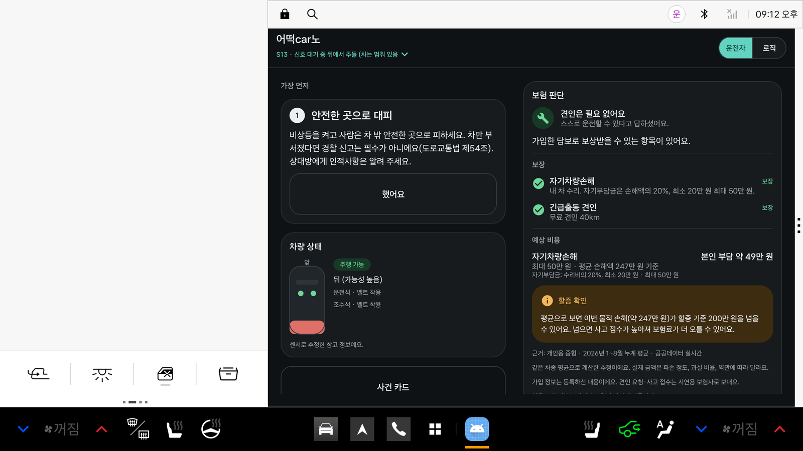
*Pleos Connect 에뮬레이터(v2.1.0, 2560×1440)에서 실행한 화면입니다. 왼쪽은 Pleos의 주행 정보, 오른쪽이 우리 앱입니다. 신호 대기 중 뒤에서 받힌 장면입니다. 차가 멈춰 있어 급정거 규칙으로는 못 잡지만, 충격 센서로 감지했고 부딪힌 곳을 "뒤(가능성 높음)"로 추정했습니다.*

## 진행 상황

| 항목 | 상태 | 비고 |
|---|---|---|
| 판단 엔진 `./gradlew :engine:test` (Android SDK 없이) | ✅ 781개 통과 | 단위·골든·불변 조건·무작위 입력 |
| 시나리오 골든 테스트 | ✅ 17개 | S01~S12(지시문 필수), S13~S17(급정거 없는 접촉 사고 감지) |
| Pleos SDK 형식 더미 차량 → 어댑터 → 엔진 | ✅ 27개 통과 (`:app`) | 17개 시나리오를 SDK 실제 타입·콜백으로 재생, 충격 계산 단위 테스트 |
| **충격 센서 감지** | ✅ | Pleos 에뮬레이터 가속도 센서에 3G 충격을 넣어 감지·방향("앞, 높음") 확인 |
| AI 보험 판단 `./gradlew :agent:test` | ✅ 23개 통과 | 가짜 모델 루프, 가짜 Claude 서버, 비용 계산, 공공데이터 API 응답 |
| **차량 화면 전용 디자인** | ✅ | Pleos 디자인 가이드·Android for Cars·NHTSA 기준. 아래 "디자인" 참고 |
| **Pleos Connect 에뮬레이터에서 실행** | ✅ | 실제 Pleos 차량 서비스(2.3.22)에 신호 등록, 값 수신 확인 |
| 내 보험 등록 → 예상 비용 | ✅ | 등록한 자기부담금·한도·할증 기준 + 공공 손해 통계 |
| 공공데이터 손해 통계 API | ✅ | 키로 실제 호출 확인 (2026년 1~8월 누계). 키가 없으면 앱 내장 통계 |
| 실차 연결 | ⚠️ | 에뮬레이터까지 확인. 실차는 아직 |
| 실제 Claude API 호출 | ⚠️ | 키가 없어 규칙 기반 판단으로 확인. 키 넣는 법은 아래 |
| 실제 보험사 API | ❌ | 가입 정보는 사용자 등록값, 견인 요청·사고 접수는 시연용 보험사(`MockInsurerApi`) |

## 화면 (Pleos 에뮬레이터에서 캡처)

캡처는 모두 Pleos Connect 에뮬레이터에서 했습니다. 앱 창 부분만 잘랐고, 원본은 2560×1440입니다. ②는 **에뮬레이터의 실제 가속도 센서**에 충격을 넣어 감지한 장면입니다. 나머지 사고 장면은 **더미 차량이 Pleos SDK 형식으로 센서 신호를 재생**하는 시나리오로 만들었습니다. 버튼을 눌러 시작한 장면은 없습니다.

### ① 대기: 센서 8종 감시
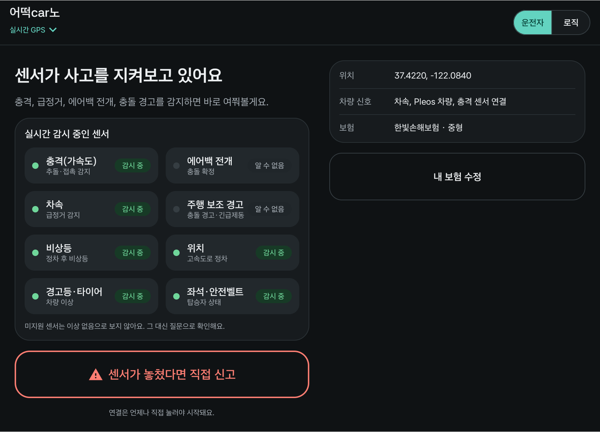

- 사고 감지에 쓰는 센서를 **역할별로** 보여 줍니다.

| 센서 | 판단에 쓰는 곳 |
|---|---|
| 충격(가속도) | 추돌·접촉 |
| 에어백 전개 | 충돌 확정 |
| 차속 | 급정거 |
| 주행 보조 경고 | 충돌 경고·긴급제동 |
| 비상등 | 정차 후 비상등 |
| 위치 | 고속도로 정차 |
| 경고등·타이어 | 차량 이상 |
| 좌석·벨트 | 탑승자 상태 |

- 각 센서의 상태(감시 중 / 알 수 없음 / 미지원)는 **실제 Pleos 차량 서비스와 기기가 알려 준 값**입니다. 이 에뮬레이터는 에어백과 주행 보조 경고의 지원 여부를 알려 주지 않아 "알 수 없음"으로 나옵니다. 미지원 센서를 "이상 없음"으로 보지 않고 질문으로 확인합니다.
- [센서가 놓쳤다면 직접 신고]는 보조 버튼입니다. 터치 영역은 크게 유지했습니다.

### ② 감지: 충격 센서 → "사고가 났나요?" (실제 센서 입력)
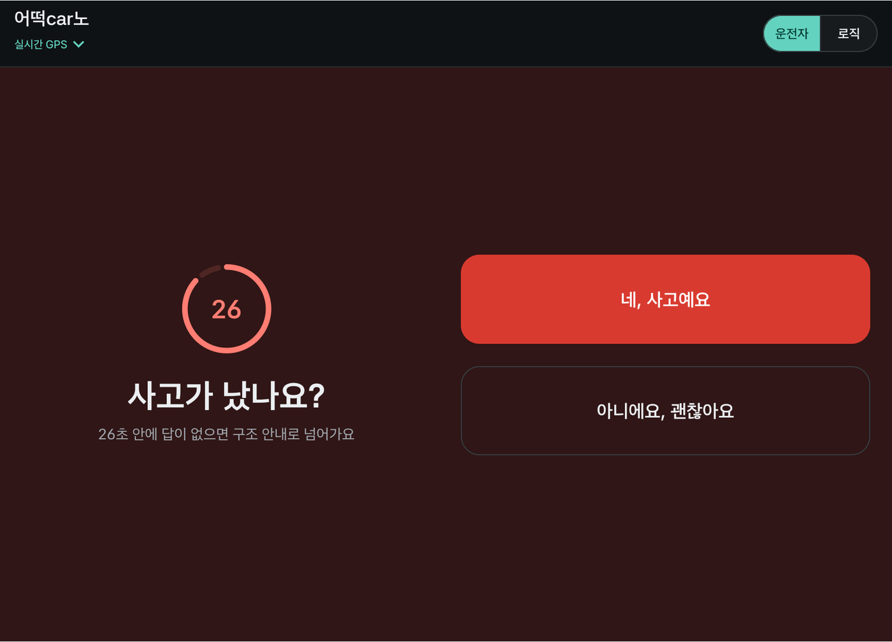

- 에뮬레이터 가속도 센서에 0.4초 동안 3G 정면 충격을 넣었습니다(`adb emu sensor set acceleration`). 버튼 없이 바로 확인 화면이 떴고, 이어진 차량 상태에서 부딪힌 곳이 "앞(가능성 높음)"으로 나왔습니다.
- 30초 안에 답이 없으면 무응답으로 보고 구조 안내로 넘어갑니다(⑨).
- 충돌 경고 직후 정차(S16)도 같은 확인 화면으로 이어집니다.

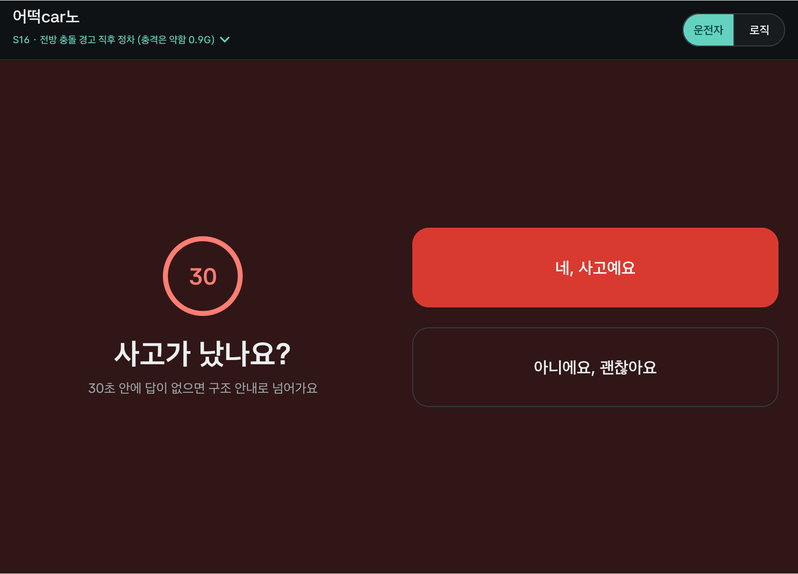

### ③ 감지 직후 차가 아직 움직일 때: 음성만
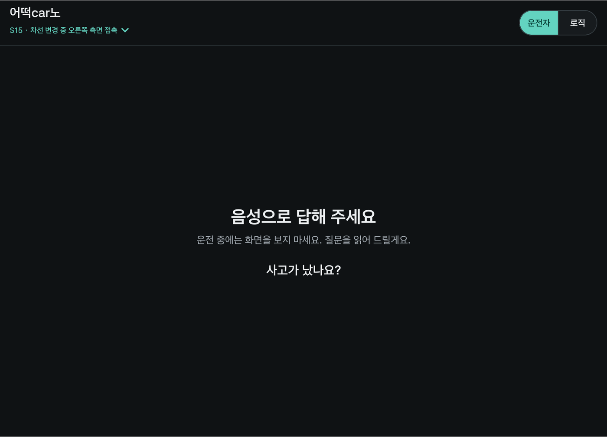

- S15(차선 변경 중 측면 접촉) 직후입니다. 차가 움직이는 동안은 화면을 보지 않도록 질문을 음성으로만 읽습니다.

### ④ 질문
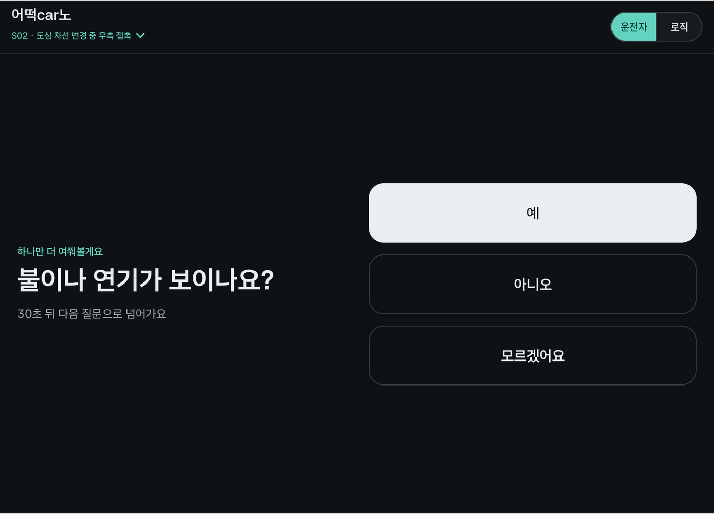

- 왼쪽에 질문 하나, 오른쪽에 같은 크기의 답 버튼 세 개를 둡니다. "예"는 위험도 안전도 뜻할 수 있어 색으로 의미를 주지 않습니다.

### ⑤ 정차 중 추돌: 부딪힌 곳 "뒤"
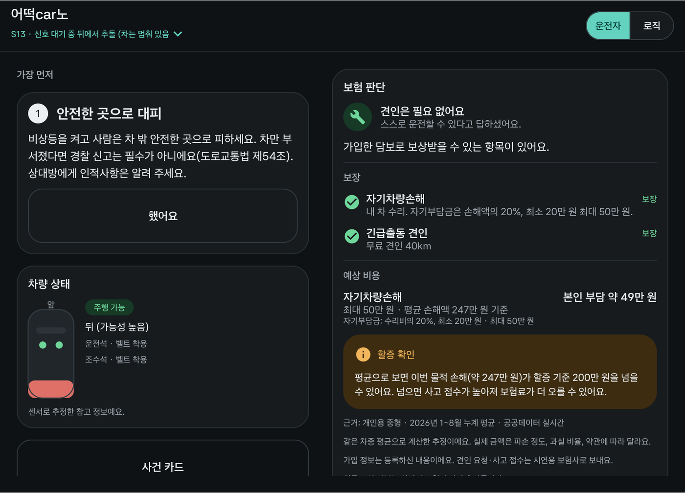

- S13: 신호 대기 중(차속 0) 뒤에서 2.8G 충격이 왔습니다. 급정거 규칙으로는 못 잡는 사고입니다.
- 충격 방향(차가 앞으로 밀림)으로 **부딪힌 곳을 "뒤(가능성 높음)"로 추정**했고, 보험사 신고 문장에도 넣습니다.
- 좌석·벨트·에어백 값이 모두 채워져 "알 수 없음"이 없습니다.
- 오른쪽 보험 판단: 견인 필요 없음, 자차 본인 부담 약 49만 원, 할증 기준 초과 가능

### ⑥ 차선 변경 중 측면 접촉: 부딪힌 곳 "오른쪽"
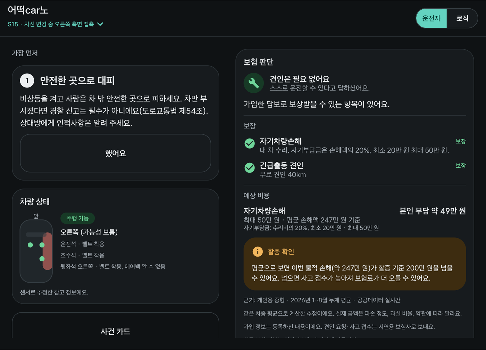

- S15: 오른쪽 깜빡이와 조향 뒤 1.9G 측면 충격이 왔고, 세게 밟지 않고 천천히 섰습니다. 부딪힌 곳은 "오른쪽"으로 추정했습니다.
- 충격 신뢰도가 중간이라 신고 문장에는 위치를 넣지 않습니다. 확실한 위치만 넣는다는 원칙입니다.

### ⑦ 에어백 전개 → 119가 1순위
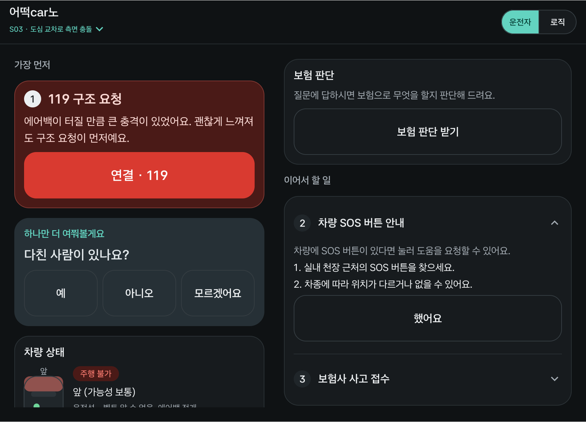

- 에어백 신호로 인명 위험(R0)이 판정되면 **119 구조 요청이 항상 1순위**입니다. 이 판단은 규칙으로 하고 AI는 관여하지 않습니다.
- 이 장면(S03)은 "일부 신호를 못 읽는 차"를 검사하는 테스트용 시나리오라 일부 좌석이 "알 수 없음"입니다.

### ⑧ 고속도로에서 차가 멈추면: 무료 긴급견인 1588-2504
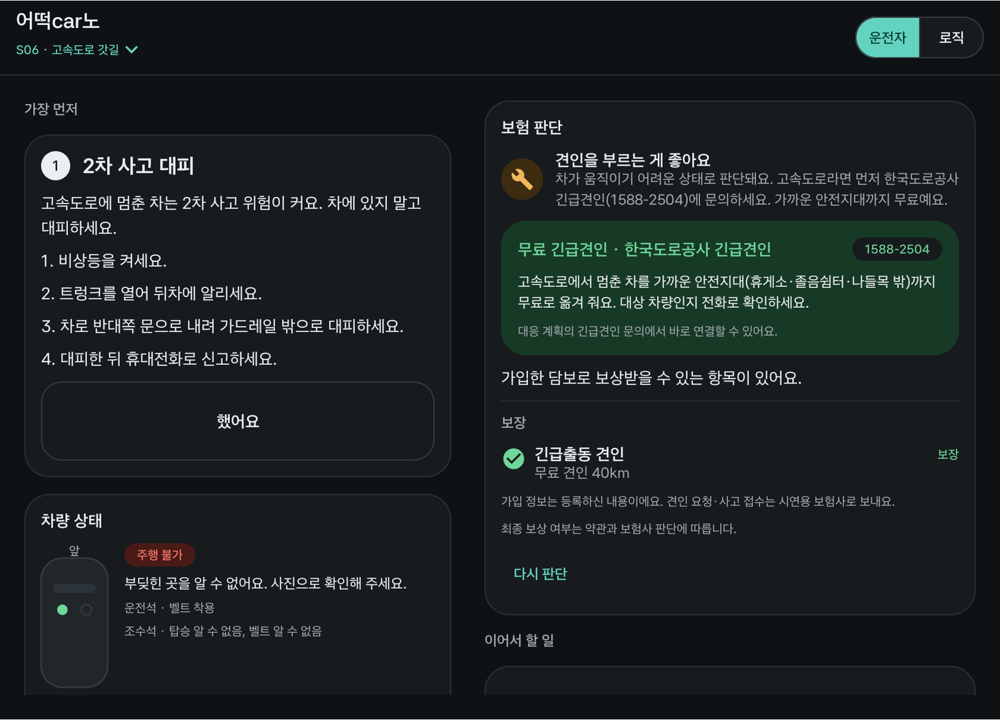

- 고속도로에서 차를 움직일 수 없으면, 보험 판단 카드의 견인 판단 바로 아래에 **한국도로공사 긴급견인(1588-2504)**을 먼저 보여 줍니다. 가까운 안전지대(휴게소·졸음쉼터·나들목 밖)까지 무료로 옮겨 줍니다.
- 대응 계획에도 "긴급견인 문의(1588-2504)" 연결 버튼이 들어갑니다. 보험사 긴급출동 견인은 그다음입니다.
- 이 번호와 안내는 AI가 아니라 규칙 엔진 판단으로 코드가 넣습니다.

### ⑨ 무응답: 구조 안내가 먼저
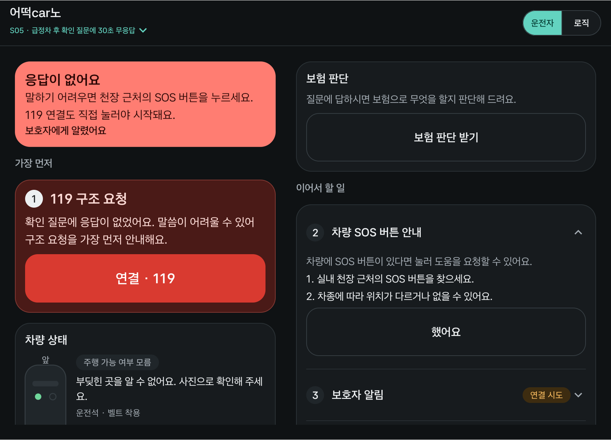

- S05(급정거 후 30초 무응답)입니다. 응답이 없으면 119가 1순위로 올라오고, 사전 동의한 보호자에게 알림을 시도합니다.
- **119 연결도 사람이 직접 눌러야 시작됩니다.** 자동 발신은 하지 않습니다.

### ⑩ 사건 카드: 센서 기록
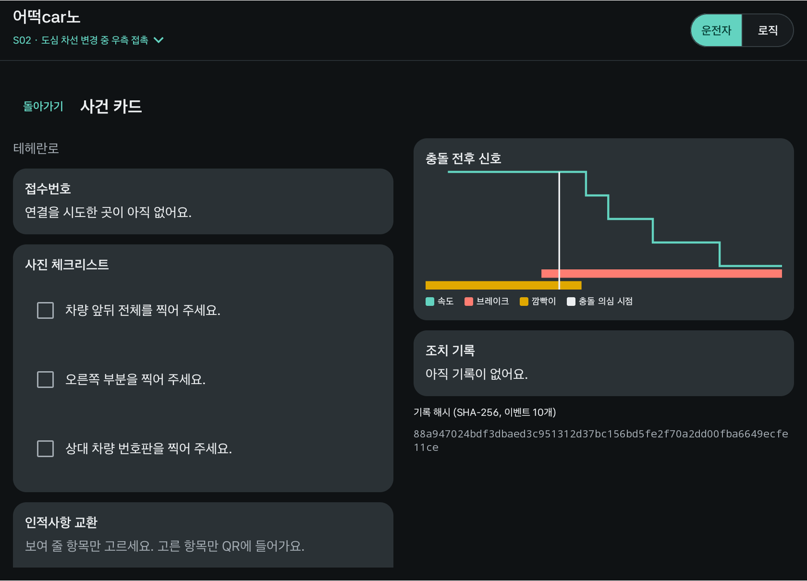

- **왼쪽:** 지금 할 일. 접수번호 입력, 사진 체크리스트(충격 위치에 맞춤), 인적사항 QR
- **오른쪽:** 기록. 충돌 전후 속도·브레이크·깜빡이 그래프와 충돌 의심 시점, 조치 기록, 기록 해시(SHA-256)

### ⑪ 내 보험 등록 (정차 중에만)
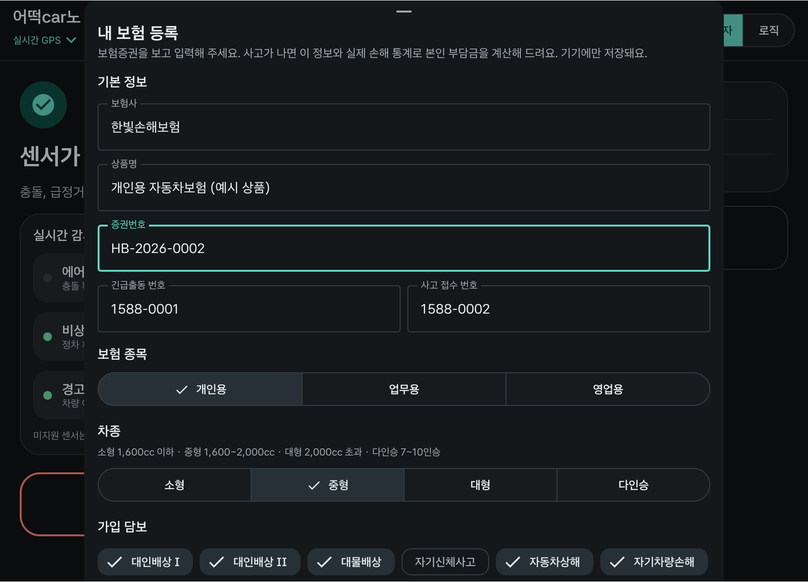

- 보험증권 내용을 입력하면 기기에만 저장합니다. 주행 중에는 열리지 않습니다.

## 사고 감지 방식

| 규칙 | 근거 신호 | 잡는 사고 | 신뢰도 |
|---|---|---|---|
| `T_AIRBAG` | 에어백 전개 | 큰 충돌 | 확정 |
| `T_IMPACT` | 차량 화면 기기의 가속도 센서. 수평 1.2G 이상 | **정차 중 추돌, 저속 접촉, 측면 접촉** | 2.5G 이상 높음, 아래면 중간 |
| `T_HARD_STOP` | 3초 안에 30km/h 이상 감속 후 정지 | 주행 중 충돌 | 높음 |
| `T_ADAS_STOP` | 전방 충돌 경고·긴급제동·후측방 경고 뒤 10초 안에 정차 | 충돌 직전 상황 | 긴급제동 높음, 그 밖 중간 |
| `T_EXPRESSWAY_STOP` | 고속도로 본선 정차 + 문 열림 또는 비상등 | 고속도로 사고 | 중간 |
| `T_STOP_HAZARD` | 정차 후 30초 안에 비상등 | 사고·고장 | 중간 |
| `T_STOP_DOOR` | 15km/h 이상 감속 정차 후 30초 안에 문 열림 (주차장 제외) | 급정거 없는 접촉 | 낮음 (묻기만 함) |
| `T_VEHICLE_WARNING` | 경고등·타이어 저압·출력 제한이 새로 켜짐 | 고장 | 중간 |

- 약한 근거는 사고로 단정하지 않고 "사고가 났나요?"로만 묻습니다. 잘못 울려도 "아니요" 한 번으로 끝납니다(S17: 승객 하차 → 종료).
- **충격 방향 → 부딪힌 곳:** 차가 밀린 반대쪽이 부딪힌 곳입니다. 한 축이 다른 축의 1.5배 이상이면 앞·뒤·왼쪽·오른쪽, 비슷하면 모서리로 봅니다. 4G 이상이면 심각도를 S2로 올립니다.
- **차속:** Pleos Vehicle SDK에는 차속 API가 없습니다. Android 표준 차속(`PERF_VEHICLE_SPEED`)을 쓰고, 받지 못하면 GPS 속도로 대신합니다.
- **주행 보조 경고:** 엔진과 시나리오(S16)는 준비됐습니다. 신호는 Pleos ADAS SDK를 받아 연결해야 합니다.
- 임계값은 모두 `engine/src/main/resources/policy/policy_v1.json`에 있고, [docs/policy-table.md](docs/policy-table.md)에 정리돼 있습니다.

## 디자인: 차량 화면 기준

휴대폰 화면을 늘려 쓰던 이전 디자인은 모두 지우고 차량 화면 전용으로 다시 만들었습니다.

| 기준 | 출처 | 적용 |
|---|---|---|
| 한 번 보는 시간 2초 이하, 작업 전체 12초 이하 | NHTSA 운전자 주의 분산 가이드라인 | 화면마다 핵심 문장 한 줄과 큰 버튼 1~3개 |
| 1~2초 안에 이해, 문단 3줄 이하 | Pleos Connect UI 디자인 가이드 | 설명·근거·면책은 작게 아래로 |
| 글자: 본문 26~30, 제목 32~40, 헤드라인 48~60, 라벨 20~24 (160dpi px) | Pleos 타이포그래피 가이드 | 토큰 × 1.75 배율 (본문 28, 제목 35, 질문 63) |
| 터치 영역 76×76dp 이상, 12.5mm 이상, 간격 23dp·4mm 이상 | Android for Cars, Pleos | 버튼 최소 133px(12.8인치 화면에서 약 15mm). 버튼 간격 28px로 Android 기준은 넘지만 Pleos 4mm(약 36px)에는 못 미침. 고칠 일로 남김 |
| 대비 4.5:1 이상, 밤에는 어두운 화면 | Android for Cars | 어두운 테마 하나. 빨강은 119·사고 신고에만 |
| 주행 중 기능 제한 (`CarUxRestrictions`) | Pleos 운전자 주의 분산 가이드 | 사고 대응 화면은 주행 중에도 사용 가능(`distractionOptimized`). 보험 등록·로직 뷰는 정차 중에만 |
| 가로형 화면, 주행 정보 영역 유지 | Pleos 디스플레이 레이아웃 | 가로 2단(왼쪽 할 일, 오른쪽 정보). 앱 창만 쓰고 주행 정보를 가리지 않음 |

- 배율은 `ui/theme/AlertTheme.kt`의 `CAR_SCALE`입니다. 차량용 Android에서만 적용됩니다.
- 바텀시트와 대화상자는 별도 창이라 `Scaled { }`로 같은 배율을 다시 적용합니다.

## Pleos 에뮬레이터에서 확인한 것

- **설치:** Pleos Connect v2.1.0 이미지(Android 14, 2560×1440)를 쓰고, 차량 서비스는 2.3.22입니다. 앱이 쓰는 SDK 2.3.2는 서비스 2.3.13 이상을 요구하므로 버전이 맞습니다.
- **충격 센서:** 에뮬레이터 가속도 센서(Goldfish 3-axis)로 충격 감지와 방향 판정을 확인했습니다. 화면 장착 방향(기기 -Z = 차 앞)은 실차에서 확인해야 합니다.
- **좌석 점유 값 문제 (Pleos 문의 필요):** SDK는 원본 값 `1`을 "탑승"으로 바꾸는데, 에뮬레이터는 Android 표준대로 빈 좌석을 `1`로 보냅니다. 그래서 에뮬레이터에서는 빈 좌석이 모두 "탑승·벨트 미착용"으로 보입니다. 앱은 SDK의 true/false만 받으므로 앱에서 고칠 수 없습니다. 자세한 내용은 [pleos-api-mapping.md](docs/pleos-api-mapping.md) 9절에 있습니다.
- **신호 수신:** 앱이 실제 Pleos 차량 서비스에 9개 신호를 등록했고 값을 받았습니다.
  - 받은 신호: 좌석 점유, 브레이크, 조향각, 방향지시등, 문, 하향등, 배터리, 출력 제한 경고, 벨트
  - 등록되지 않은 신호: 에어백, 타이어 공기압, 경고등. 이 에뮬레이터가 지원 여부를 확인해 주지 않아 등록하지 않았고, 앱은 "알 수 없음"으로 처리합니다.
- **가상 콘솔:** 에뮬레이터 안 `http://<에뮬레이터>:8088`(adb 포트 포워딩)에서 브레이크, 문, 좌석, 비상등, 기어 등 63가지를 바꿀 수 있습니다.
  - 차속, 에어백 전개, 충돌 신호는 콘솔에 없습니다. 그래서 사고 장면은 더미 차량 시나리오로 재생했습니다.
  - 콘솔은 1초마다 `/browser/session`으로 신호를 보내야 활성화됩니다.
- **CRN 주입:** 문서의 `adb root` + `vhal_fifo` 방식은 이 이미지(배포용 user 빌드)에서 root가 막혀 동작하지 않았습니다. CRN 없이도 차량 신호는 받았습니다.
- **이번에 고친 멈춤(ANR):** 차량 서비스가 느리거나 재시작 중이면 바인더 호출이 오래 막히는데, 이 호출들이 메인 스레드에 있어서 앱이 강제 종료됐습니다.
  - 고친 곳: 차량 연결(`Car.createCar`, `getCarManager`), Pleos SDK 초기화·등록·해제
  - 지금은 모두 전용 스레드(`platform/CarThread.kt`)나 IO 스레드에서 합니다.
  - `android.car`는 연결 완료 콜백을 항상 메인 스레드로 보내므로, 콜백 안의 작업도 다시 전용 스레드로 넘깁니다.

## 구조

```
engine/   순수 Kotlin. 규칙 기반 사고 판단 (감지·파손·위험 등급·조치 계획·세션)
agent/    순수 Kotlin. AI 보험 판단 (Claude 도구 루프, 보험사 API, 비용 계산, 공공 통계)
app/      Android 앱 (Compose, 차량 화면 전용). 센서를 모아 엔진·에이전트에 넣고 결과를 그린다
docs/     pleos-api-mapping.md, engine-contract.md, policy-table.md(자동 생성), screenshots/
```

```
Pleos 센서 ─┐
GPS·차속   ─┼─▶ engine (규칙) ─▶ 사고 감지 → 질문 → 위험 등급·조치 계획 ─▶ 운전자 화면
            │                        │
            │                        ▼
            └──────────────▶ agent (Claude) ─▶ 보험 조회 → 비용 계산 → 판단 → [사용자 승인] → 견인 요청·사고 접수
```

## AI 보험 판단 (`agent/`)

- **모델:** `claude-opus-5-5` (Claude Java SDK 3.8.0). 거절되면 서버 측 대체 모델로 넘어가도록 켜 두었습니다.
- **AI가 쓰는 도구:**

| 도구 | 종류 | 하는 일 |
|---|---|---|
| `get_incident_summary` | 조회 | 규칙 엔진이 판단한 사고 요약 |
| `get_insurance_policy` | 조회 | 가입 담보·한도·자기부담금·무료 견인 거리 |
| `check_coverage` | 조회 | 이번 사고 유형에서 보상되는 담보 |
| `estimate_claim_costs` | 조회 | 등록한 보험 조건 + 공공 손해 통계로 담보별 예상 본인 부담, 할증 기준 초과 가능성 |
| `quote_tow` | 조회 | 가까운 협력 정비소까지 거리, 초과 요금 |
| `request_emergency_tow` | **실행** | 보험사 긴급출동 견인 접수 |
| `file_accident_claim` | **실행** | 보험사 사고 접수 |
| `submit_decision` | 결과 | 견인 여부, 담보별 보장, 요약 |

- **실행 도구는 사용자가 승인 시트에서 [진행하기]를 눌러야만 실행됩니다.** 같은 조치는 한 번만 실행되고, 보험사가 준 접수번호는 사건 기록에 남습니다.
- **112·119 연결 도구는 AI에게 없습니다.** 인명 관련 판단과 연결은 규칙 엔진과 사람의 확인이 맡습니다.
- **API 키가 없거나 AI가 실패하면 규칙 기반 판단으로 대신합니다.** 화면은 항상 결과를 보여 줍니다.
- **금액은 AI가 만들지 않습니다.** 예상 비용은 코드(`CostEstimator`)가 계산하고, AI가 다른 금액을 적어도 화면에는 계산값만 나옵니다.

### 내 보험 등록과 예상 비용

- **입력 항목:** 보험사, 상품명, 증권번호, 긴급출동·사고 접수 번호, 보험 종목, 차종, 가입 담보, 대물 한도, 자차 자기부담금(비율·최소·최대), 물적사고 할증기준금액, 무료 견인 거리
- **통계:** 금융위원회_자동차보험가입정보 `getLosCircumstance`. 같은 종목·차종·담보의 건당 평균 손해액(손해액 ÷ 건수, 자체 계산)
- **적용 범위:** 실시간 모드는 등록한 보험을 쓰고, 시나리오 S01~S12는 시나리오의 프로필을 씁니다.
- **나중에 바꿀 곳:** 보험 마이데이터나 보험사 제휴 API가 생기면 `PolicyStore`만 채우면 됩니다.

> 이 값은 **평균 기반 추정**입니다. 실제 수리비는 파손 정도와 과실 비율에 따라 크게 다릅니다. 가입 권유나 "보험 처리하지 마세요" 같은 조언은 하지 않습니다.

### 키 넣기

`local.properties`(git에 올라가지 않음)에 추가한 뒤 다시 빌드합니다.

```properties
anthropic.apiKey=sk-ant-...
# 공공데이터포털 "금융위원회_자동차보험가입정보" 활용 신청 후 받은 키 (없으면 앱 내장 통계)
datagokr.serviceKey=...
# Pleos Playground 프로젝트 정보 (Vehicle Data API 연동 예정, 아직 코드에서 쓰지 않음)
pleos.clientId=...
pleos.clientSecret=...
pleos.testCrn=...
```

> **주의:** 키를 앱에 넣는 것은 시연용입니다. APK에서 키를 꺼낼 수 있으므로 배포할 때는 서버를 거쳐야 합니다.

## 빠른 시작

필요한 것: JDK 17 이상(Android Studio의 `jbr`도 됨). 앱 빌드에는 Android SDK가 필요합니다.

```bash
./gradlew :engine:test :agent:test       # Android SDK 불필요
./gradlew :app:testDebugUnitTest         # 더미 Pleos 차량 → 어댑터 → 엔진
./gradlew :app:assembleDebug             # app/build/outputs/apk/debug/app-debug.apk
./gradlew :engine:generatePolicyDoc      # 정책을 고친 뒤 docs/policy-table.md 재생성
```

Windows Git Bash 예: `export JAVA_HOME="/c/Program Files/Android/Android Studio/jbr"`

### Pleos 에뮬레이터에서 실행

1. Android Studio SDK Manager에 Pleos Connect 이미지 사이트를 추가하고 설치합니다(약 4GB). 자세한 순서는 Pleos 문서의 "Setup Connect SDK Emulator"를 따릅니다.
2. AVD 설정: Automotive, Pleos Connect v2.1.0, RAM 4GB, **콜드 부팅**. 퀵 부팅이면 VHAL을 쓸 수 없습니다.
3. `adb install -r -g app/build/outputs/apk/debug/app-debug.apk`를 실행한 뒤, 하단 독의 앱 아이콘으로 실행합니다.
   - `am start`로 실행하면 Pleos가 내비를 앞으로 띄웁니다. 독 아이콘으로 실행하세요.
4. 시나리오 재생(디버그 빌드만):

```bash
adb shell am broadcast -a com.alertbridge.app.DEBUG_SCENARIO --es scenario S03   # S01~S12
adb shell am broadcast -a com.alertbridge.app.DEBUG_SCENARIO --es scenario live  # 실시간
```

## 앱 사용법

- **입력 바꾸기:** 상단의 입력 이름(예: "실시간 GPS ▾")을 누릅니다.
  - **실시간:** 실제 GPS를 쓰고, 차량용 Android면 차속, Pleos 서비스가 있으면 차량 신호도 씁니다.
  - **S01~S12:** 더미 차량이 Pleos SDK 형식으로 사고 상황을 재생합니다.
- **운전자 / 로직 전환(디버그 빌드, 정차 중만):** 로직 탭에서 판단 과정, 기대값 비교, Pleos 콜백, AI 판단 원본을 봅니다.
- **디버그 빌드는 [연결]을 눌러도 전화 앱을 열지 않습니다.** 테스트 중 실수로 112·119에 걸리지 않게 하기 위해서입니다. 릴리스 빌드에서만 번호를 띄우고(`ACTION_DIAL`), 발신은 사람이 직접 합니다.

## 안전 원칙 (바꾸지 않는다)

- 112·119·보험사에 **자동 발신하지 않습니다.** 앱에 직접 발신 권한이 없습니다.
- AI가 실행하는 조치(견인 요청·사고 접수)는 **매번 사용자 승인**을 받습니다.
- 인명 위험(R0)이면 `CALL_119`가 항상 1순위입니다. 위험 등급과 기관 선택은 규칙 기반이며 LLM을 쓰지 않습니다.
- "연결 시도"와 "접수 완료"를 분리합니다. 접수번호가 있어야 완료입니다.
- 지원되지 않는 신호는 "없음"이 아니라 "알 수 없음"입니다.
- 사고 확정 전에는 신호·위치를 저장하지 않습니다.
- 신고 문장에는 확실한 충격 위치만 넣습니다.

**면책:** 파손 추정과 보험 판단은 참고 정보입니다. 최종 보상 여부는 약관과 보험사 판단에 따릅니다. 가입 권유 문구는 넣지 않습니다.

## 팀원별 시작점

- **차량 센싱 / Pleos 연결:**
  - 계약: [docs/engine-contract.md](docs/engine-contract.md) 6절
  - 코드: `app/.../adapter/PleosSignalSource.kt`, `LiveSources.kt`(차속·실차 연결), `platform/CarThread.kt`
  - 실차에서 확인할 항목: [pleos-api-mapping.md](docs/pleos-api-mapping.md) 7절
- **보험 연동:**
  - 실제 보험사 API(제휴 API 또는 보험 마이데이터)는 `agent/.../insurance/InsurerApi.kt`의 인터페이스를 구현하면 됩니다.
  - 비용 계산은 `CostEstimator.kt`, 통계는 `agent/.../stats/ClaimStats.kt`입니다.
- **AI 판단 개선:** `agent/.../advisor/InsuranceAdvisor.kt`의 시스템 프롬프트와 `ToolBox.kt`의 도구 정의를 고칩니다.
- **UI:**
  - 코드: `app/.../ui/driver/`(운전자 화면), `ui/theme/`(디자인 토큰, `CAR_SCALE`, `CarPanes`)
  - 판단 로직은 UI에 넣지 않습니다. 새 화면도 가로 2단(`CarPanes`)과 위 디자인 기준을 따릅니다.
- **정책·문구:** `engine/src/main/resources/policy_v1.json`, `messages_ko.json`

## 지시문과 달라진 점

- **SDK 버전:** 필요한 메서드가 2.3.2에만 있어 `Vehicle:2.3.2`를 씁니다. Pleos 에뮬레이터의 서비스 2.3.22와 호환됩니다.
- **에어백:** 종류(정면·측면)를 주지 않습니다. 실차에서는 측면 충돌도 "앞(MEDIUM)"으로 추정되며, 신고 문장에는 넣지 않습니다.
- **비상등, 도로 종류, 차량 크기:** SDK에 없습니다. 엔진은 고속도로인지 묻고, 2504 견인은 도로를 확실히 알 때만 제안합니다.
- **LLM 사용:** 지시문은 판단에 LLM을 쓰지 않는다고 했지만, 요청에 따라 **보험 판단과 실행에만** Claude를 씁니다. 위험 등급·119 판단은 여전히 규칙 기반입니다.
- **확인 질문:** "괜찮으세요? 사고인가요?"는 "예"의 뜻이 모호해 "사고가 났나요?"로 바꿨습니다.
- **휴대폰 화면:** 차량 내장 앱으로 정해 휴대폰 레이아웃은 지웠습니다.
- **2504 긴급견인 안내:** 지시문은 도로를 확실히 알 때만 2504를 제안하라고 했습니다. 지금은 **운전자가 고속도로라고 답했고 주행 불가면** 도로 판정이 불확실해도 안내합니다. 전화로 대상 여부를 묻는 것이라 안내하는 쪽이 낫다고 봤습니다.

## 알려진 문제와 남은 일

- **원인 불명 오류:** 질문 화면을 빠르게 넘길 때 부상 질문에 "예"가 기록된 일이 있었습니다(자동 탭 테스트에서 3번 중 2번). 사람이 누를 때도 생기는지, 원인이 무엇인지 아직 확인하지 못했습니다.
- **차량 기능:**
  - 실차 연결 확인. 화면 장착 방향과 충격 임계값 보정, 좌석 점유 값 해석 확인
  - Pleos ADAS SDK로 주행 보조 경고 연결
  - 음성 신고("사고 났어"): 차량 음성 비서(Gleo AI) 연동이 필요해 아직 못 함
  - Pleos 가상 콘솔로 차속·충돌을 흉내 낼 방법
  - CRN 주입(root 가능한 이미지 필요)
- **외부 API:**
  - 실제 AI 판단 호출 확인(키 필요, Gemini 키로 시험 예정)
  - 실제 보험사 API(견인·접수)
  - Pleos Vehicle Data API·보험 마이데이터 연동
- **아직 가짜인 것:** 손해 통계는 평균값뿐이라 파손 정도별 수리비 분포는 반영하지 못합니다. STT와 보호자 알림은 가짜 구현이고, 국토부 견인 운임표(`towFareTable`)는 비어 있습니다.
- **측정과 리뷰:** 릴리스 빌드 성능은 측정하지 않았습니다. 새 차량 디자인에 대한 독립 UX 리뷰도 아직 하지 않았습니다.

## 퍼미션

- 위치: `ACCESS_FINE/COARSE_LOCATION`
- 네트워크: `INTERNET` (주소 변환, Claude API, 공공데이터)
- 차속: `android.car.permission.CAR_SPEED`
- Pleos 차량 신호: `pleos.car.permission.CAR_SAFETY`·`CAR_SEATS`·`CAR_DOORS`·`CAR_LIGHTS`·`CAR_DRIVE`·`CAR_ENERGY`·`CAR_INFO`

Pleos 퍼미션은 App Market과 협의·승인된 범위에서만 쓸 수 있습니다.
